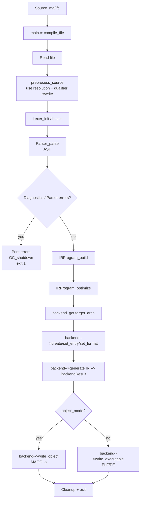
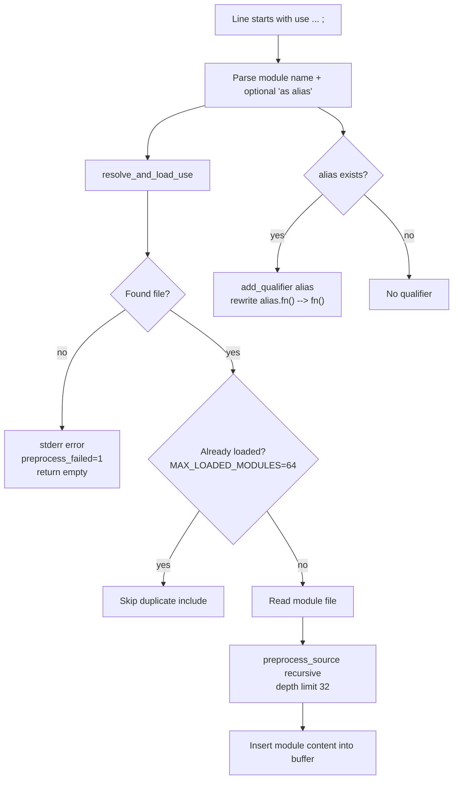
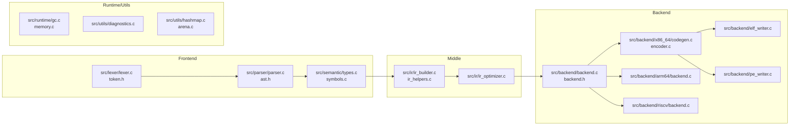
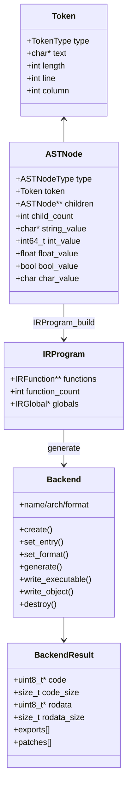
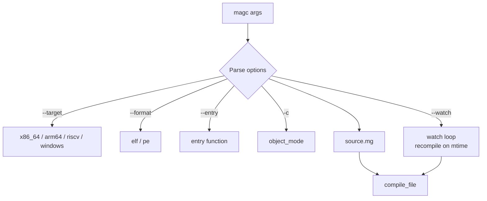

# 25 — مخطط Mermaid لعمل مترجم Magnetar

**حالة الدعم:** ✅ توثيق معماري (يعكس الحالة الحالية لـ `magc`)

هذا الملف يوضح مسار الترجمة في Magnetar بشكل بصري باستخدام Mermaid، مع ربط كل مرحلة بالملفات الفعلية في `src/`.

## 1) خط الأنابيب العام

## 2) المعالجة المسبقة `use`

`preprocess_source()` تعمل قبل Lexer/Parser، وتقوم بتوسيع الوحدات نصياً.

**مسارات البحث عن الوحدة** (مختصر):
- `source_dir/lib/<name>`
- `source_dir/<name>`
- `<name>` مباشرة
- `lib/<name>`
- `MAGNETAR_LIB/MAGNETAR_PATH/MAGNETAR_HOME`
- مسارات النظام (`/usr/lib/magnetar/lib`, `~/.magnetar/lib`, إلخ)

## 3) مراحل المترجم والملفات

## 4) بنية البيانات الرئيسية

## 5) CLI ومسار التنفيذ

## 6) ملاحظات حالة حالية

- **x86_64 ELF**: المسار الأكثر نضجاً.
- **PE64**: كتابة/تنسيق مدعوم، لكن توليد الكود ما زال يعتمد Linux syscall/ABI في أماكن كثيرة (راجع حدود PE الحالية).
- **arm64/riscv**: backends موجودة وقيد الإكمال.
- **`src/codegen/` و`src/backup_c/`**: legacy/غير مبنية؛ `src/mag.c` رابط `./mag`.

## ملفات مرجعية

- `src/main.c` — CLI, preprocessing, compile pipeline.
- `src/lexer/lexer.c`, `src/lexer/token.h`
- `src/parser/parser.c`, `src/parser/ast.h`
- `src/ir/ir_builder.c`, `src/ir/ir_optimizer.c`, `src/ir/ir.c`
- `src/backend/backend.h`, `src/backend/backend.c`
- `src/backend/x86_64/codegen.c`, `src/backend/x86_64/encoder.c`
- `src/backend/elf_writer.c`, `src/backend/pe_writer.c`
