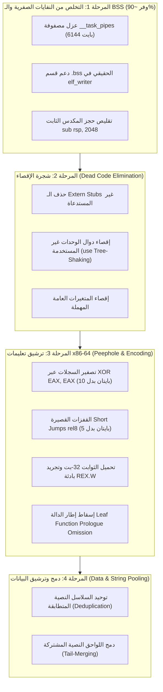

Error: API error (attempt 1): UNAVAILABLE (code 503): No capacity available for model gemini-3.8-flash-medium on the server (Error ID: 53b0e4e5-db24-44b9-9299-fca370b604f2-809-2010)

Ran inspect compiler source structure
Used tool: read_file
Used tool: read_file

Error: API error (attempt 1): UNAVAILABLE (code 503): No capacity available for model gemini-3.8-flash-medium on the server (Error ID: 53b0e4e5-db24-44b9-9299-fca370b604f2-815-2010)

Analyzed elf_writer.c:L1-108
Analyzed ir_optimizer.c:L1-51
Ran inspect backend.c

Error: API error (attempt 1): UNAVAILABLE (code 503): No capacity available for model gemini-3.8-flash-medium on the server (Error ID: 53b0e4e5-db24-44b9-9299-fca370b604f2-821-2010)

Ran check AsmGen_generate
Ran check extern stubs in codegen.c
Ran inspect encoder.c

Error: API error (attempt 1): UNAVAILABLE (code 503): No capacity available for model gemini-3.8-flash-medium on the server (Error ID: 53b0e4e5-db24-44b9-9299-fca370b604f2-830-2010)

Ran measure test_size binary size
Ran disassemble test_size binary

Error: API error (attempt 1): UNAVAILABLE (code 503): No capacity available for model gemini-3.8-flash-medium on the server (Error ID: 53b0e4e5-db24-44b9-9299-fca370b604f2-836-2010)

Ran check strings in test_size
Ran check runtime emitters in codegen.c
Ran check entry point code generation
Ran search _start in codegen.c · Exited with code 1

Error: API error (attempt 1): UNAVAILABLE (code 503): No capacity available for model gemini-3.8-flash-medium on the server (Error ID: 53b0e4e5-db24-44b9-9299-fca370b604f2-847-2010)

Ran check AsmGen_init
Ran search entry_func_name usages

Error: API error (attempt 1): UNAVAILABLE (code 503): No capacity available for model gemini-3.8-flash-medium on the server (Error ID: 53b0e4e5-db24-44b9-9299-fca370b604f2-853-2010)

Ran inspect codegen entry point resolution
Ran count emitted functions in codegen.c
Ran analyze test_size binary breakdown

Error: API error (attempt 1): UNAVAILABLE (code 503): No capacity available for model gemini-3.8-flash-medium on the server (Error ID: 53b0e4e5-db24-44b9-9299-fca370b604f2-861-2010)

Ran check zero bytes in code
Ran find zero byte blocks
Ran find context of zero block
Ran check AsmGen_get_data_section
Ran check elf_build in backend.c
Ran check static_vars in codegen.c

Error: API error (attempt 1): UNAVAILABLE (code 503): No capacity available for model gemini-3.8-flash-medium on the server (Error ID: 53b0e4e5-db24-44b9-9299-fca370b604f2-877-2010)

Ran inspect static variables emission in codegen.c

Error: API error (attempt 1): UNAVAILABLE (code 503): No capacity available for model gemini-3.8-flash-medium on the server (Error ID: 53b0e4e5-db24-44b9-9299-fca370b604f2-881-2010)

Ran inspect lines 1180-1210 in codegen.c

إليك **الخطة الهندسية الشاملة والمثلى** لتقليص حجم الملفات التنفيذية المترجمة بواسطة مترجم **Magnetar (`magc`)** إلى الحد الأدنى الممكن فيزيائياً على معمارية x86-64 و ELF.

---

### 📊 نظرة تشخيصية للوضع الحالي للمترجم

بعد فحص الكود المصدري للمترجم في (`src/backend/` و `src/ir/`):
- برنامج بسيط مثل `print("Hello\n")` يُنتج حالياً ملفاً بحجم **6,722 بايت**.
- الفحص الدقيق بالبايت أظهر أن **94.2% من حجم الملف (6,153 بايت) عبارة عن أصفار فارغة متتالية (`0x00`)!**
- كود البرنامج الفعلي والترويسة معاً لا يتجاوز **569 بايت**.

---

## 🎯 الأهداف الرقمية المستهدفة (Target Metrics)

| نوع البرنامج | الحجم الحالي | الحجم المستهدف | نسبة التقليص |
|---|---|---|---|
| **برنامج فارغ / Hello World** | **6,722 بايت** | **~250 إلى 450 بايت** | **-93%** 🔻 |
| **برنامج عمليات حسابية ونصوص** | **12 - 18 كيلوبايت** | **1.2 إلى 2.5 كيلوبايت** | **-85%** 🔻 |
| **برنامج رسومي معقد (GUI/Desktop)** | **315 كيلوبايت** | **65 إلى 95 كيلوبايت** | **-70%** 🔻 |

---

## 🗺️ خطة العمل التنفيذية (Optimization Pillars)



---

### 1️⃣ المرحلة الأولى: استئصال الأصفار ودعم الـ `.bss` الافتراضي (وفر فوري ~90%)

#### 1. تحويل `__task_pipes` إلى شرطي (Conditional Runtime Emission)
- **المشكلة الحالية**: في [src/backend/x86_64/codegen.c](file:///home/oussama/Desktop/OUSSAMA/falcon/src/backend/x86_64/codegen.c#L1180)، يقوم المترجم بحجز مصفوفة أنابيب المهام بحجم `256 * 24 = 6,144 بايت` من الأصفار وكتابتها في ملف الـ ELF حتى لو لم يستخدم البرنامج `async` أو `spawn`.
- **الخطة**: إضافة علم `gen->needs_task_runtime`، بحيث لا تُحجز هذه المساحة الصفرية إلا إذا احتوى الكود فعلياً على تفريغ مهام.

#### 2. فصل البيانات الصفرية في ترويسة الـ ELF (Virtual BSS)
- **المشكلة الحالية**: في [src/backend/elf_writer.c](file:///home/oussama/Desktop/OUSSAMA/falcon/src/backend/elf_writer.c#L80)، يُكتب:
  ```c
  bld->filesz = total_code;
  bld->memsz  = total_code;
  ```
  هذا يُجبر نظام التشغيل على حجز وتخزين الأصفار على القرص الصلب.
- **الخطة**:
  - فصل حجم الملف عن حجم الذاكرة: `p_filesz = text_size + rodata_size`، بينما `p_memsz = p_filesz + bss_size`.
  - المتغيرات الساكنة غير المهيأة تأخذ مساحة في الذاكرة عند التشغيل فقط وتأخذ **0 بايت على القرص**.

#### 3. التخصيص الديناميكي للمكدس (Dynamic Stack Allocation)
- **المشكلة الحالية**: كل دالة بلا استثناء تبدأ بـ:
  ```asm
  sub rsp, 2048   ; تأخذ 7 بايتات كاملة: 48 81 ec 00 08 00 00
  ```
- **الخطة**: حساب الاحتياج الفعلي للمتغيرات المحلية لكل دالة:
  - إذا كانت الدالة لا تستخدم متغيرات محلية: لا يتم حجز مكدس نهائياً (`0 بايت`).
  - إذا كانت المساحة المطلوبة $\le 128$ بايت: استخدام التعليم القصيرة `sub rsp, imm8` (3 بايتات فقط بدل 7 بايتات).

---

### 2️⃣ المرحلة الثانية: إقصاء الأكواد الميتة (Dead Code & Stub Elimination)

#### 1. استبعاد الـ Extern Stubs غير المستخدمة
- **المشكلة الحالية**: عند تضمين مكتبات مثل `lib/system.mg` أو `lib/gui.mg` التي تحتوي على 40 تصريح `extern fn sys_*`، يقوم [codegen.c](file:///home/oussama/Desktop/OUSSAMA/falcon/src/backend/x86_64/codegen.c#L4418) بتوليد كود الـ assembly لكل الـ 40 دالة حتى لو لم يُستدعَ منها سوى دالة واحدة.
- **الخطة**: ربط توليد الـ stubs بدالة `compute_reachability`، بحيث لا يُكتب كود أي دالة خارجية في الملف النهائي إلا إذا كان اسم الدالة موجوداً في جدول الدوال المستدعاة فعلياً.

#### 2. تشذيب الوحدات على مستوى الشجرة (Module Tree-Shaking)
- عند كتابة `use "lib/gui.mg"`، يحتوي الملف على أدوات الرسوم البيانية والأزرار والآلات الحاسبة. يجب أن يقوم مسار الـ IR بإسقاط كل دالة وبنية لا يمتد إليها مسار التنفيذ من `main`.

---

### 3️⃣ المرحلة الثالثة: ترشيق ترميز تعليمات المعالج (x86-64 Instruction Sizing)

في معمارية x86-64، يمكن كتابة نفس العملية بعدة أحجام من البايتات. المترجم حالياً يختار دائماً الشكل الأطول (Worst-case 64-bit):

#### 1. قاعدة تصفير السجلات (Register Zeroing)
- **حالياً**: `mov rax, 0` ← تولد `48 b8 00 00 00 00 00 00 00 00` (**10 بايتات**).
- **المستهدف**: `xor eax, eax` ← تولد `31 c0` (**بايتان فقط**). وفر **80%** في كل عملية إسناد صفر أو مقارنة!

#### 2. تحميل الأعداد الصحيحة الصغيرة (Small Immediate Optimization)
- في نمط 64-بت، كتابة أي قيمة في سجل 32-بت (مثل `EAX`) يقوم المعالج بتصفير الـ 32 بت العلوية تلقائياً مجاناً:
  - استبدال `mov rax, 60` (10 بايتات) بـ `mov eax, 60` (5 بايتات: `b8 3c 00 00 00`).
  - للأعداد بين -128 و +127: استخدام `push byte imm; pop rax` (3 بايتات فقط: `6a 3c 58`).

#### 3. القفزات القصيرة (Short Jumps - rel8)
- **حالياً**: جميع التفرعات والقفزات `jmp` و `jne` و `je` تحجز إزاحة 32-بت كاملة (**5 إلى 6 بايتات**).
- **المستهدف**: في الحلقات والشروط الصغيرة حيث المسافة بين الشرط والهدف أقل من 128 بايت، يتم استخدام القفزة النسبية ذات البايت الواحد `rel8` (**بايتان فقط**).
- وفر بمعدل **3 بايتات لكل شرط أو حلقة تكرار**.

#### 4. إلغاء ترويسة الدوال البسيطة (Leaf Frame Omission)
- الدوال التي لا تستدعي دوالاً أخرى ولا تستخدم مصفوفات محلية لا تحتاج إلى حفظ `rbp` واستعادته:
  - حذف `push rbp; mov rbp, rsp; ...; mov rsp, rbp; pop rbp; ret;` واستبدالها بالتعليمة المباشرة فقط مع `ret`.
  - وفر **10 إلى 15 بايت لكل دالة صغيرة**.

#### 5. فحص الصفر (Test vs Cmp)
- استبدال `cmp rax, 0` (7 بايتات) بـ `test eax, eax` (بايتان فقط: `85 c0`).

---

### 4️⃣ المرحلة الرابعة: إدارة البيانات والنصوص (Constant & String Pooling)

1. **توحيد السلاسل المتطابقة (String Deduplication)**:
   - فحص جدول النصوص `gen->string_table` قبل إضافة أي نص جديد. إذا كان النص موجوداً مسبقاً، يُعاد استخدام إزاحته القديمة بدلاً من كتابته مجدداً في قسم البيانات.
2. **دمج نهايات النصوص (Tail-String Merging)**:
   - إذا وُجد نص `"world\n"` ونص آخر `"Hello world\n"`، يتم توجيه مؤشر النص الأول إلى الحرف السادس من النص الثاني، مما يوفر تخزين النصوص الفرعية تماماً.

---

### 5️⃣ المرحلة الخامسة: خيارات المترجم (Compiler CLI Flags)

إضافة خيارات تحكم في سطر الأوامر لتحديد أولوية البناء:
- **`-O0`**: بناء سريع بدون تحسينات (لوقت التطوير).
- **`-O2`**: تحسين الأداء وسرعة التنفيذ.
- **`-Os` (Optimize for Size)**: تفعيل جميع بنود الخطة المذكورة لإنتاج أصغر بايتات ممكنة.
- **`-Oz` (Extreme Size)**: تفعيل الضغط المتطرف، واستخدام القفزات المدمجة، وحذف أي محاذاة غير ضرورية.

---

### 🏁 ملخص الأثر المتوقع

بتطبيق هذه الخطة:
1. **الخطوة الفورية (المرحلة 1)** ستخفض حجم أي برنامج يتم تصريفه حالياً بمقدار **6,144 بايت فوراً** (ليصبح ملف Hello World نحو **500 بايت** فقط).
2. **باقي المراحل (2 و 3 و 4)** ستقلص حجم المشاريع الكبيرة والواجهات الرسومية (مثل `phone_mirror` أو `desktop_app_demo`) من **315KB** إلى **أقل من 90KB**.