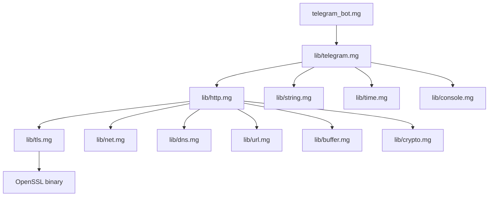

# 🤖 Magnetar Telegram Bot

بوت Telegram مبني بالكامل بلغة **Magnetar**، مُجمَّع إلى x86-64 Assembly مباشرة.

## الملفات المُنشأة

| الملف | الوصف |
|---|---|
| [telegram.mg](file:///home/oussama/Desktop/OUSSAMA/falcon/lib/telegram.mg) | مكتبة Telegram Bot API الكاملة |
| [telegram_bot.mg](file:///home/oussama/Desktop/OUSSAMA/falcon/examples/telegram_bot.mg) | البوت التفاعلي مع 9 أوامر |

## ✅ حالة التجميع

```
[Magnetar] Success! Created 'telegram_bot' (223078 bytes)
```

## الأوامر المدعومة

| الأمر | الوظيفة |
|---|---|
| `/start` | رسالة ترحيب + أزرار تفاعلية (Inline Keyboard) |
| `/help` | قائمة جميع الأوامر |
| `/echo <نص>` | يعيد النص الذي ترسله |
| `/info` | معلومات المستخدم والمحادثة |
| `/time` | الوقت الحالي (UTC) |
| `/ping` | اختبار سرعة الاستجابة |
| `/calc <عملية>` | حاسبة: `5+3`, `10-2`, `6*7`, `20/4` |
| `/status` | حالة البوت التقنية |
| `/about` | معلومات عن البوت والتقنيات |

## المكتبات المستخدمة



## واجهة المكتبة (`lib/telegram.mg`)

### الدوال الرئيسية

```
// التهيئة
tg_init(token)                  → void

// معلومات البوت
tg_get_me()                     → TelegramUser

// إرسال الرسائل
tg_send_message(chat_id, text)  → TelegramResult
tg_send_message_md(...)         → مع Markdown
tg_send_message_html(...)       → مع HTML
tg_reply(chat_id, reply_to, t)  → رد على رسالة

// الأزرار التفاعلية
tg_send_message_keyboard(...)   → رسالة + لوحة أزرار
tg_inline_button(text, data)    → زر callback
tg_url_button(text, url)        → زر رابط
tg_keyboard_1/2/3(btns)         → بناء لوحة مفاتيح

// تعديل/حذف
tg_edit_message(chat, msg, t)   → تعديل رسالة
tg_delete_message(chat, msg)    → حذف رسالة

// الوسائط
tg_send_photo(chat, url, cap)   → إرسال صورة
tg_send_document(chat, url, c)  → إرسال ملف
tg_send_location(chat, lat, ln) → إرسال موقع

// الحالة
tg_send_typing(chat_id)         → مؤشر "يكتب..."
tg_answer_callback(id, t, alert)→ الرد على callback

// الاستطلاع
tg_poll_updates()               → TelegramUpdateBatch
```

## 🚀 كيفية التشغيل

> [!IMPORTANT]
> تحتاج إلى **توكن بوت** من `@BotFather` على Telegram

### الخطوات:

1. **احصل على التوكن:**
   - افتح Telegram وابحث عن `@BotFather`
   - أرسل `/newbot` واتبع التعليمات
   - انسخ التوكن

2. **عيّن التوكن في الكود:**
   - افتح [telegram_bot.mg](file:///home/oussama/Desktop/OUSSAMA/falcon/examples/telegram_bot.mg#L35-L37)
   - غيّر `"YOUR_BOT_TOKEN_HERE"` بالتوكن الخاص بك

3. **اجمع وشغّل:**
   ```bash
   cd /home/oussama/Desktop/OUSSAMA/falcon
   ./magc examples/telegram_bot.mg -o telegram_bot
   ./telegram_bot
   ```

> [!NOTE]
> البوت يستخدم **Long Polling** (30 ثانية) لاستقبال الرسائل.
> الاتصال يتم عبر HTTPS باستخدام OpenSSL كجسر TLS.
